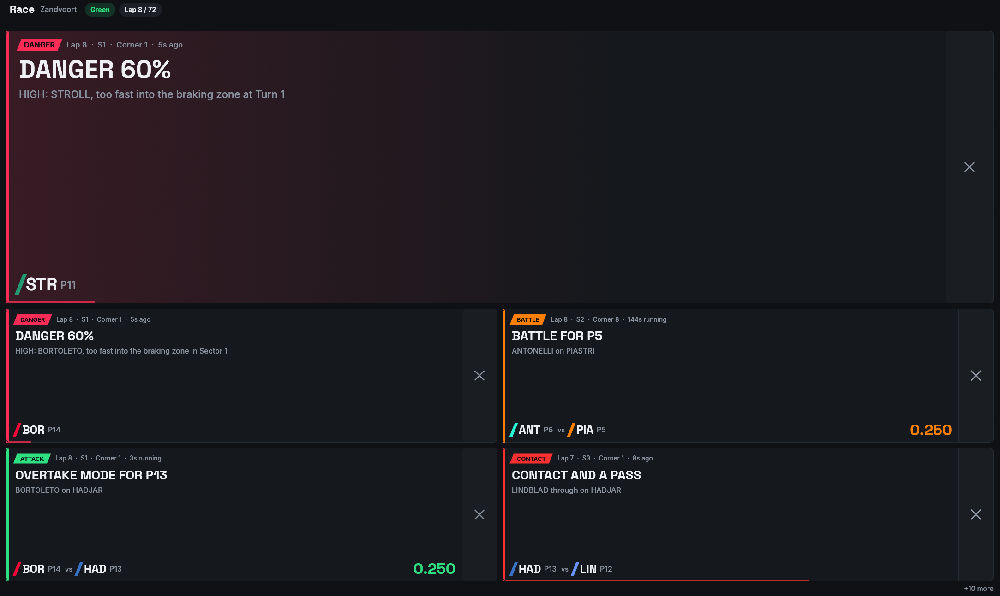
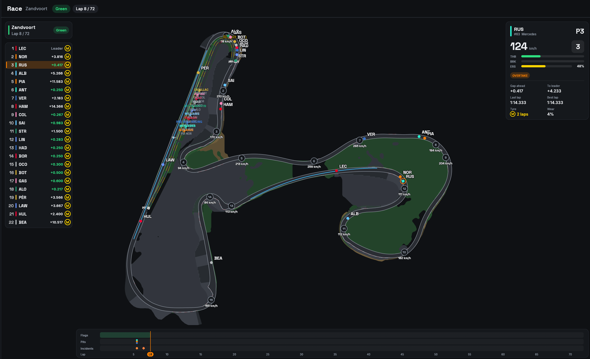
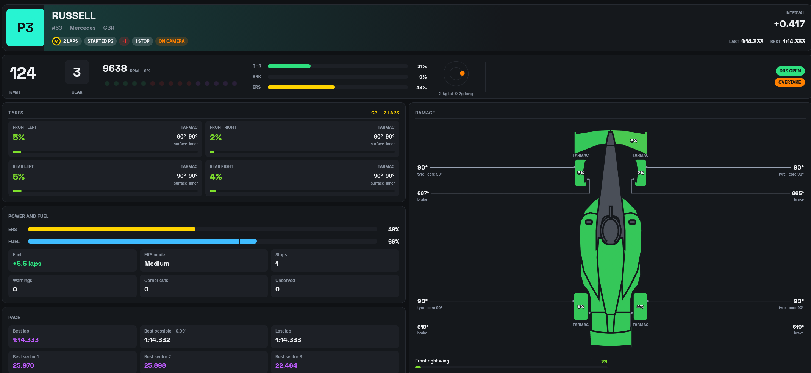
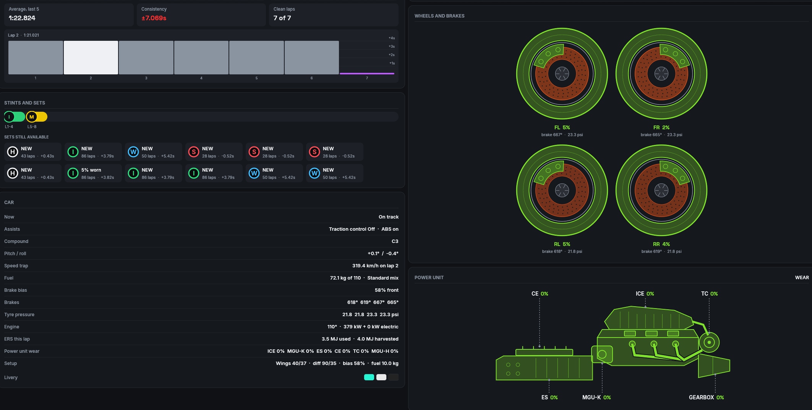
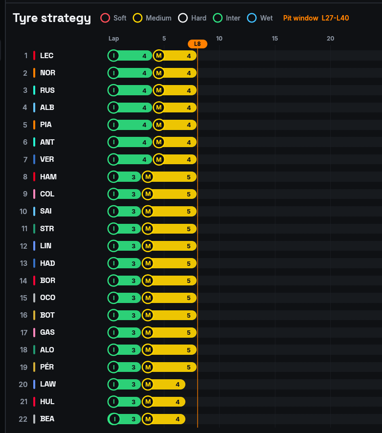
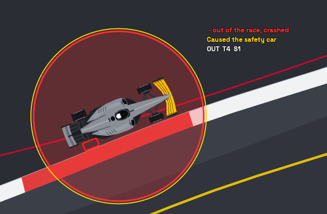
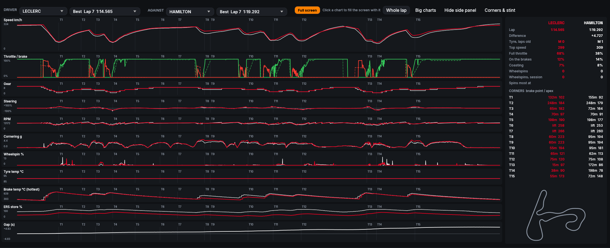
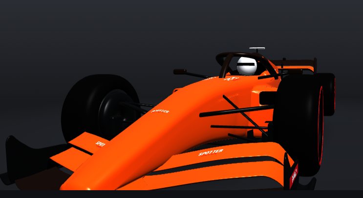
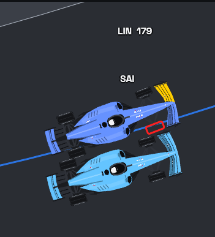

# Spotter

**Race control for your F1® 25 league broadcast.** Spotter reads the game's telemetry and turns it into a live broadcast desk: race cards that surface every battle, overtake and crash the moment it happens, full timing and tyre strategy, driver pages, a track map, lap-by-lap telemetry and an auto camera director that cuts your spectator view to the action for you.

**[⬇ Download the latest version](https://github.com/Zetenypapp/spotter-releases/releases/latest)** — grab `Spotter_x.y.z_x64-setup.exe` from the release and run it. Windows only, no admin rights needed.

---

## What it looks like

The **race cards** read the whole field and push the stories that matter to the top — battles, danger warnings, contact, overtakes — so you never miss the moment:

A **track map** that Spotter draws itself as the cars run, with live positions, gaps, sectors and the flag/incident timeline along the bottom:

---

## Free vs Spotter Pro

Everything below works the moment you install. The **Pro** features unlock with a key.

| Free | Spotter Pro |
| --- | --- |
| Race cards — battles, overtakes, contact, danger, penalties, retirements, pit stops, flags, weather, fastest lap, speed trap | **Track map** — self-drawing, live positions and gaps |
| Live timing & leaderboard | **Telemetry** — lap-by-lap charts, two drivers compared |
| Tyre strategy & pit windows | **Camera director** — auto-cuts your spectator view to the action |
| Driver pages — tyres, damage, fuel, ERS, pace | **Danger model** — predicts who's about to bin it |
| Stewards' log — every incident, contact and penalty | **OBS overlays** — leaderboard, map and driver graphics as browser sources |
| Session, weather & race-control info | **3D views** — the car, battles and replays in 3D |
| Phone / tablet page over your network | **Map builder** & **replay** — review any moment of the race |

### Driver pages *(free)*

Every car, lap by lap: tyres and wear, damage, fuel, ERS, pace and consistency.

### Tyre strategy *(free)*

The whole field's stints and compounds at a glance, with the pit window called for you:

### Stewards' log *(free)*

Spotter flags contact, crashes and the cause of every safety car — click any incident to replay it:

### Telemetry *(Pro)*

Any two drivers' laps side by side — speed, throttle, brake, gears, cornering g, tyre and brake temps, ERS and the gap, corner by corner:

### 3D views *(Pro)*

The 2026 car in your league's colours, live battles and replays rendered in 3D:

 

---

## Quick start

### 1. Install

Run the setup file and follow the steps. No admin rights are needed.

Windows may say "Windows protected your PC", because Spotter is a new app. Click **More info**, then **Run anyway**.

On first start, Windows asks whether Spotter may use the network. Allow it on **private networks**: that's how the game's telemetry reaches Spotter, and how phones and OBS open its pages.

### 2. Turn on telemetry in F1 25

In the game: **Settings → Telemetry Settings**.

| Setting | Set it to |
| --- | --- |
| UDP Telemetry | On |
| UDP Broadcast Mode | Off |
| UDP IP Address | `127.0.0.1` if Spotter runs on the same PC; otherwise the Spotter PC's IP address |
| UDP Port | `20777` |
| UDP Send Rate | 60 Hz |
| UDP Format | 2025 |
| Your Telemetry | Public (so others in the lobby see your tyres and damage) |

Start any session. Spotter switches from "Waiting for telemetry" to the race within a second or two.

**Using SimHub too?** SimHub usually takes port 20777. In SimHub, forward the F1 25 data to another port (for example `20778`). Then in Spotter, **Settings → Open settings folder**, open `config.toml`, set `port = 20778` under `[udp]`, and restart Spotter.

### 3. Unlock Spotter Pro

After buying, your key arrives by email. In Spotter: **Settings → Spotter Pro**, paste the key, click **Use key**. Pro switches on straight away.

The key is checked online when Spotter starts, and keeps working for 14 days without internet. If a monthly key runs out, Pro switches off the next time Spotter starts, never during a race.

### 4. Your league's look

**Settings → Look**: choose your league's logo (PNG or JPEG) and team colour, and a light, dark or league theme.

### 5. Phones, tablets and OBS

- **Phone or tablet:** click **Share** in the menu and scan the QR code. Anyone on your network can follow the race in their browser.
- **OBS map overlay (Pro):** add a **Browser Source** with `http://localhost:8080/broadcast`. The map-building view is `http://localhost:8080/builder`.
- **Pop-out map (Pro):** open it from the Track map screen and add it to OBS with **Window Capture**. It keeps running with Spotter minimised.
- **OBS scene switching:** in `config.toml` (Settings → Open settings folder), fill in the `[obs]` section with your OBS WebSocket port and password, and set `enabled = true`.

### 6. Camera director (Pro)

In **Settings → Director**, set the keys your game uses to move the camera to the next and previous car, then switch the camera on. **Go** on a card cuts to that car; **Auto** follows the action by itself. Keep the game window in front: Spotter only presses your camera keys, and never while it has focus itself.

## Something not working?

| What you see | What to do |
| --- | --- |
| Stuck on "Waiting for telemetry" | Check UDP Telemetry is On and the IP and port match (step 2). If the game is on another PC, allow Spotter through Windows Firewall on private networks. |
| "Wrong UDP format" | Set UDP Format to 2025 in the game. |
| Spotter says the port is taken | Another program (often SimHub) has 20777. Forward from it to another port (step 2). |
| A driver's tyres and damage are blank | That driver has Your Telemetry set to Restricted. Only they can change it. |
| Your key isn't accepted | Check it's pasted whole, with the dashes. Each key works on a limited number of PCs; contact us to move it to a new one. |

Your settings, maps and key are kept in `%APPDATA%\Spotter`. Updating or uninstalling never removes them.

---

Spotter is not affiliated with or endorsed by Formula 1, the FIA, Codemasters or Electronic Arts. F1® 25 is a trademark of its respective owners.
